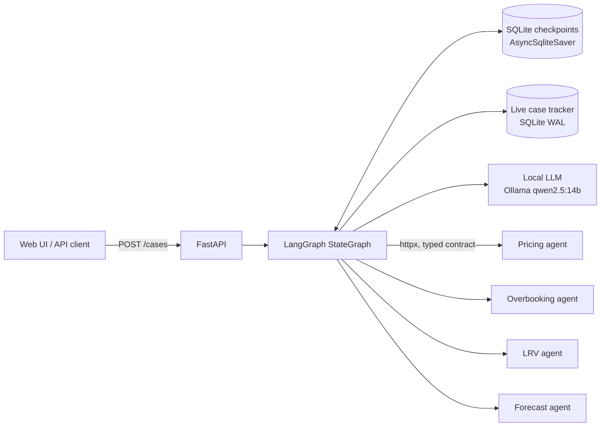
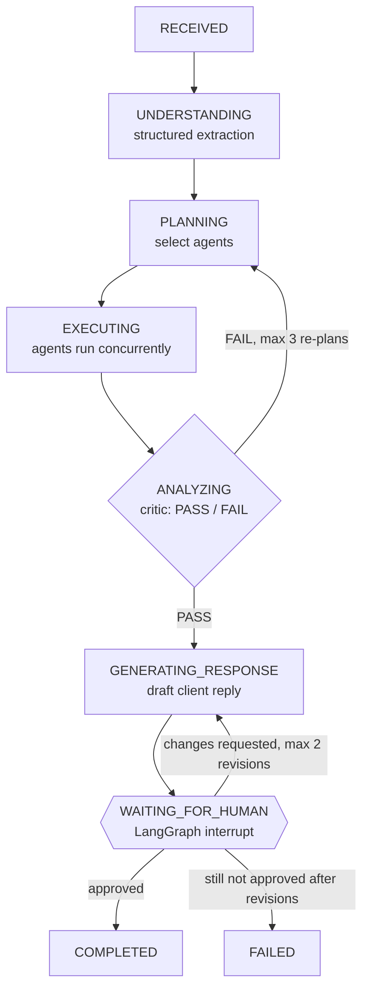

<div align="center">



[🌐 Portfolio](https://shubham-ai-lab.vercel.app/) · [👤 GitHub profile](https://github.com/Shubham261299) · [💼 LinkedIn](https://www.linkedin.com/in/shubham-jamdar-2571271b3)

</div>

# Agentic Case-Routing Orchestrator

> A LangGraph orchestration engine that investigates support cases with pluggable AI agents, critiques its own evidence, and **waits for a human to approve the drafted response** before a case can complete.


> **About the source code:** I built this project at my current employer, IDeaS Revenue Solutions (hotel revenue-management software), and the code is proprietary. This repository documents the project (architecture, flow, engineering decisions and results) so I can walk through it in detail.

---

## Why I built it

Revenue-operations support teams answer a steady stream of client cases about pricing, overbooking, Last Room Value and forecasts. Each type needs a different investigation, and the domain logic belongs to different specialist teams.

I built the **orchestration layer** those teams plug their agents into:

- the orchestrator owns understanding, planning, dispatch, critique, drafting, state and the human approval gate;
- each domain agent is an **independent service** behind a typed contract;
- **nothing reaches the client without a person approving it.**

---

## Architecture



## How a case flows



- **The local LLM has four jobs:** understanding the case (schema-constrained extraction), planning and re-planning which agents to call, **critiquing the evidence** (PASS/FAIL), and drafting and revising the client response.
- **Bounded re-planning:** on a FAIL, the planner may add at most one new agent per iteration, for up to 3 iterations. It stops early when nothing new is proposed.
- **Human approval gate:** the graph calls LangGraph's `interrupt()` and only resumes through `Command(resume=…)` on the same thread. The reviewer either **approves** or **requests changes**, which triggers a bounded revision loop.

---

## Key engineering details

| Area | What I implemented |
|---|---|
| Pluggable agents | Agents are standalone services speaking one Pydantic v2 contract (task input, task result, evidence, agent card). Adding an agent is a registry entry, not a graph change |
| Concurrency | Each case runs as its own async task on its own thread ID, and the agents inside a case are dispatched concurrently |
| Durable state | Every step is checkpointed with `AsyncSqliteSaver`, so a paused case lives on disk, not in memory |
| Live status | Business data goes to a separate WAL-mode SQLite tracker, so the status API updates the instant an agent starts or finishes |
| Execution trace | Every LLM step and agent dispatch records its input, output and duration |
| LLM output hardening | Schema-constrained JSON → one repair re-prompt → an explicit error instead of a guess; values normalised by validators |
| Deterministic fallback | If the planner's output is invalid, it falls back to keyword routing, and agent IDs the model invents are filtered against the registry |
| Failure isolation | 20-second agent timeouts. A connection error, timeout or bad response becomes a FAILED task, not a crashed case; an unknown agent returns NOT_SUPPORTED |
| Safe approvals | The approval endpoint returns **409** unless the case is actually waiting for a human |
| Observability | Structured JSON logs correlated by case, task and agent |

## API

| Method | Endpoint | Purpose |
|---|---|---|
| `POST` | `/cases` | Submit a case |
| `GET` | `/cases` | List cases with live status |
| `GET` | `/cases/{id}` | Full state, plan, agent results and execution trace |
| `POST` | `/cases/{id}/approval` | Approve, or request changes with a comment |

A lightweight web UI polls the live status every 1.5 seconds.

<details>
<summary><b>Illustrative interaction</b> (fake data)</summary>

```json
POST /cases
{ "subject": "Rates look too low for next weekend", "description": "Client says BAR dropped 20% for Fri–Sat." }

GET /cases/c-1024   →   { "status": "WAITING_FOR_HUMAN",
                          "plan": ["pricing", "forecast"],
                          "critic": "PASS",
                          "draft_response": "…" }

POST /cases/c-1024/approval
{ "decision": "APPROVED" }            →   { "status": "COMPLETED" }
```
</details>

---

## What I verified

| Check | Result |
|---|---|
| Kill the orchestrator while a case is `WAITING_FOR_HUMAN`, then restart (manual test) | The case was still waiting, with its state intact |
| End-to-end runs against the local model | 2 full runs through to the approval gate, including re-plan loops with all agents completing |
| Routing categories vs. real data | Analysed a ~41,000-case Salesforce support export to validate the categories the agents cover |

## Design decisions

| Decision | Why |
|---|---|
| Orchestrator as infrastructure, agents as services | Domain teams own their logic; the orchestrator owns flow, state and safety |
| Approval as a graph `interrupt()` | The model can't skip it, because the pause is part of the execution graph |
| A critic plus *bounded* re-planning | Better answers without runaway loops or runaway cost |
| Checkpoint state separate from live tracker | Durable resume *and* instant status updates |
| Local LLM via Ollama | Client case data never leaves the machine |

## Stack

Python 3.13 · LangGraph (StateGraph, interrupt, AsyncSqliteSaver) · FastAPI · Uvicorn · Pydantic v2 · httpx · Ollama (qwen2.5:14b) · SQLite (WAL)

## Status and next steps

- **Working prototype**, run end to end against a local model; not yet deployed to a team.
- The four domain agents are **mocked on purpose**, with realistic data and latency. The real logic comes from the domain teams, with no orchestrator changes needed.
- **Next:** automated test suite, authentication and locked-down CORS, idempotent approvals, locked tracker writes for higher load, agent self-registration, and live case ingestion once data access is approved.

## How I built it

Planned, scaffolded and iterated with **Claude Code** as my main development tool. I owned the architecture, the approval and safety design, and the verification.

---

**Shubham Jamdar** · [LinkedIn](https://www.linkedin.com/in/shubham-jamdar-2571271b3) · [GitHub](https://github.com/Shubham261299)
